<a href="https://dncreative.studio">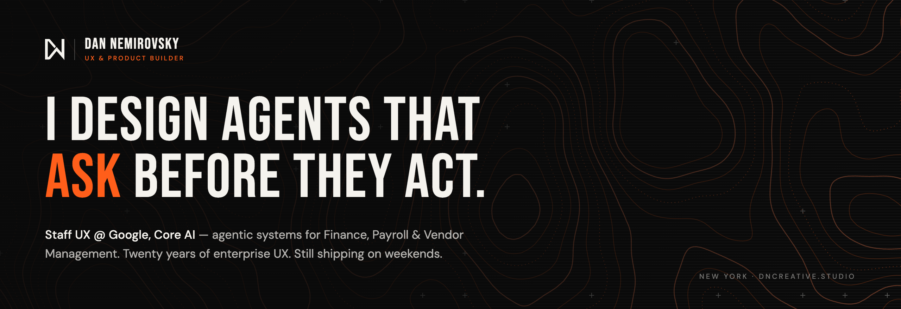</a>

 

I'm Dan. **UX & Product Builder.** Twenty years designing enterprise products in places where a bad click costs real money: retirement, healthcare, automotive, and now the financial backbone of Google.

The job changed. Interfaces used to wait for people. Now they act on their behalf. My work is making sure they do it **legibly, reversibly, and with permission.** By day that's agentic systems at Google. By night it's a personal AI operating system on a Mac mini in my house. Same problem, different blast radius.

 

## `01` · NOW — GOOGLE CORE AI

**Staff UX, Core AI.** Designing agent-forward experiences for the systems that pay people and the vendors that keep the lights on:

| Domain | What I'm designing for |
|:--|:--|
| **Finance** | Agents that reconcile, flag and draft, with humans holding the pen on anything that moves money |
| **Payroll** | High-stakes, zero-tolerance flows where "the AI was confident" is never an acceptable answer |
| **Vendor Management** | Onboarding, contracts and spend, turned from ticket queues into assisted workflows |

The through-line: **trust is a UX surface.** Show the reasoning, scope the autonomy, make undo cheap, and ask before the irreversible stuff.

 

## `02` · MIMIR·OS — THE NIGHT SHIFT

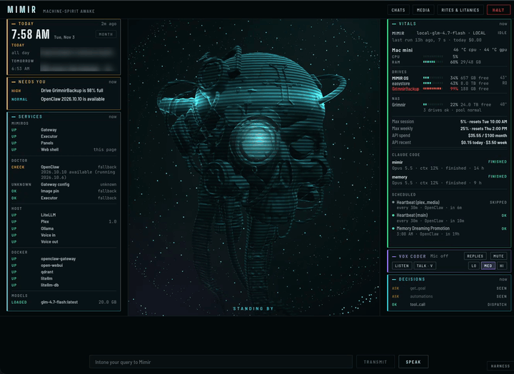

**A personal AI operating system on one Mac mini.** Mail, calendar, media, voice and hardware, run by a local-first agent that asks before it acts. Every decision it makes lands in a ledger (`ASK` → `SEEN` → `DISPATCH`) so I can see what it wanted to do, not just what it did.

- **Stack:** OpenClaw gateway · Claude Code · Ollama (local models) · LiteLLM · Qdrant · Docker · TypeScript HUD
- **Voice in, voice out.** Talk to it, or don't. It runs on heartbeats either way.
- **Local-first by default.** Cloud models are a fallback, not a dependency, and API spend sits on the dashboard where I can't ignore it.
- **MimirOS Kit:** the starter kit version, so you can build your own. Extended from [Jarvis OS](https://github.com/MCKRUZ/jarvis-os) by McKruz.

It's my lab for the exact questions I solve at work: autonomy levels, consent, memory, and what a good "needs you" alert actually looks like.

 

## `03` · THE WORKBENCH — SHIPPED & LIVE

Designed, built and deployed end to end. Brand → system → code → production. No templates were harmed.

<table>
<tr>
<td width="50%" valign="top">
<a href="https://dncreative.studio">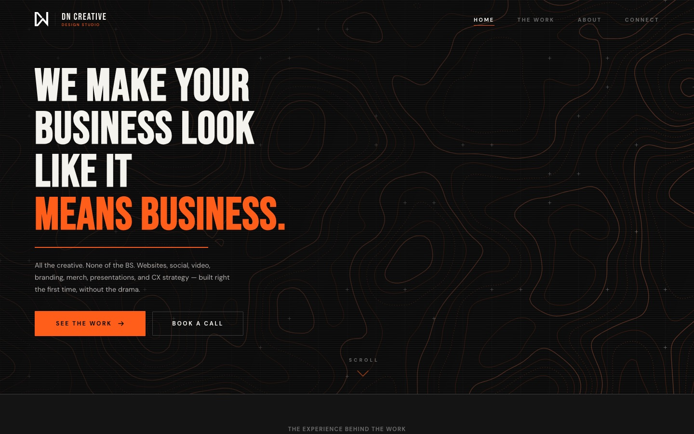</a>
 <b><a href="https://dncreative.studio">DN Creative Studio</a></b> 
My design studio. Brand system, live generative topo, the works. Design that doesn't blend in.
</td>
<td width="50%" valign="top">
<a href="https://dannemirovsky.com">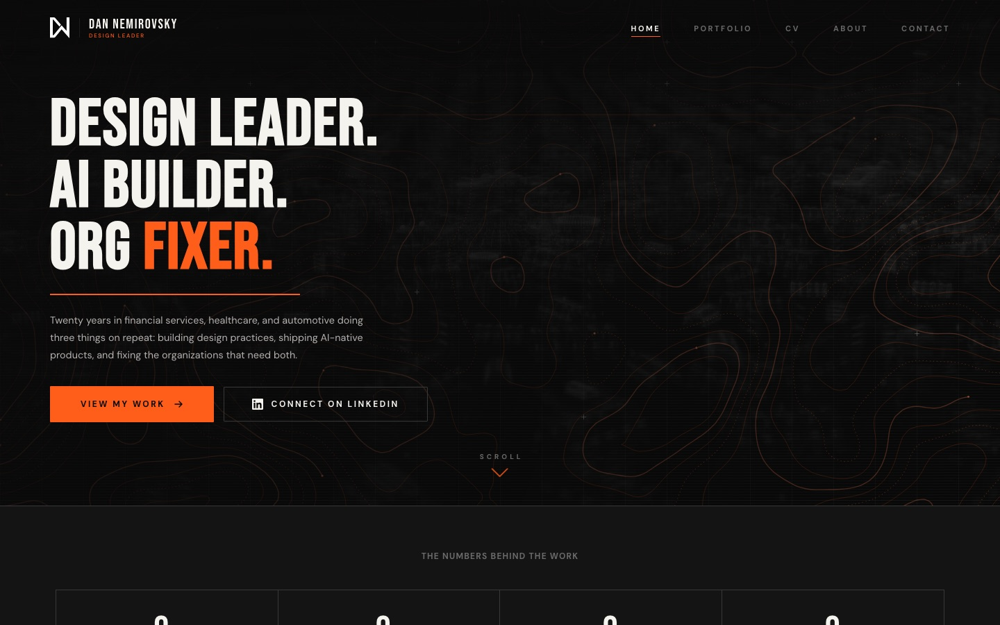</a>
 <b><a href="https://dannemirovsky.com">dannemirovsky.com</a></b> 
Portfolio & case studies. Prudential's LIV, Northwell's design system, and the receipts.
</td>
</tr>
<tr>
<td width="50%" valign="top">
<a href="https://hekbot.netlify.app">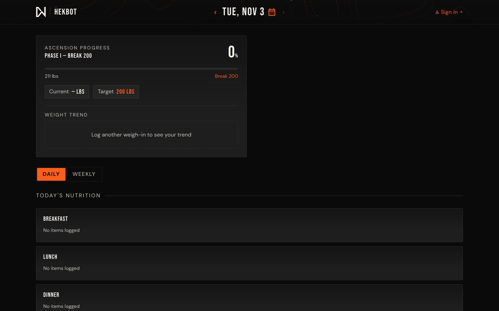</a>
 <b><a href="https://hekbot.netlify.app">HekBot</a></b> 
AI fitness, nutrition & solar coach. React · Vite · Supabase · Google Fit · an LLM that nags with love.
</td>
<td width="50%" valign="top">
<a href="https://hub.dncreative.studio">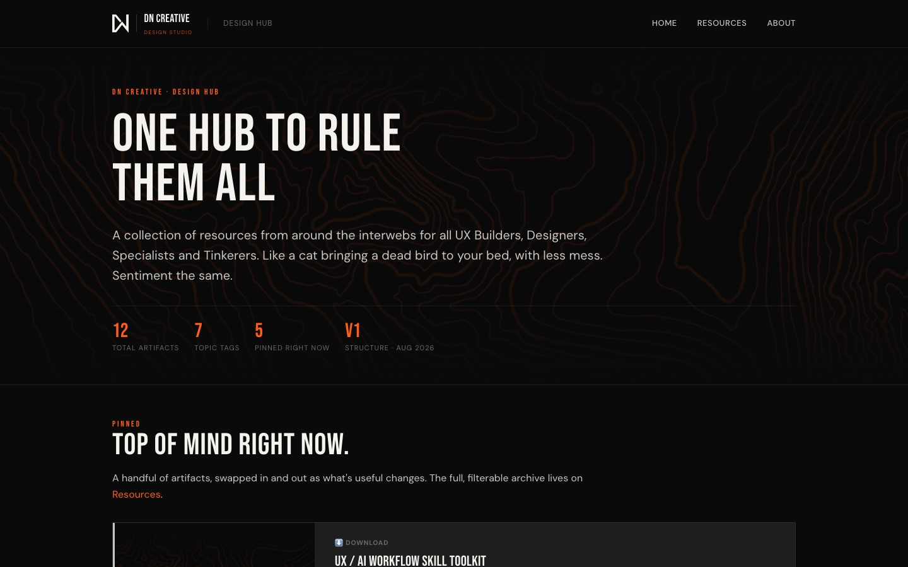</a>
 <b><a href="https://hub.dncreative.studio">DN Design Hub</a></b> 
A curated archive of UX / AI artifacts and skill toolkits for builders. Data-driven, zero framework.
</td>
</tr>
<tr>
<td width="50%" valign="top">
<a href="https://rebootcampcoaching.com">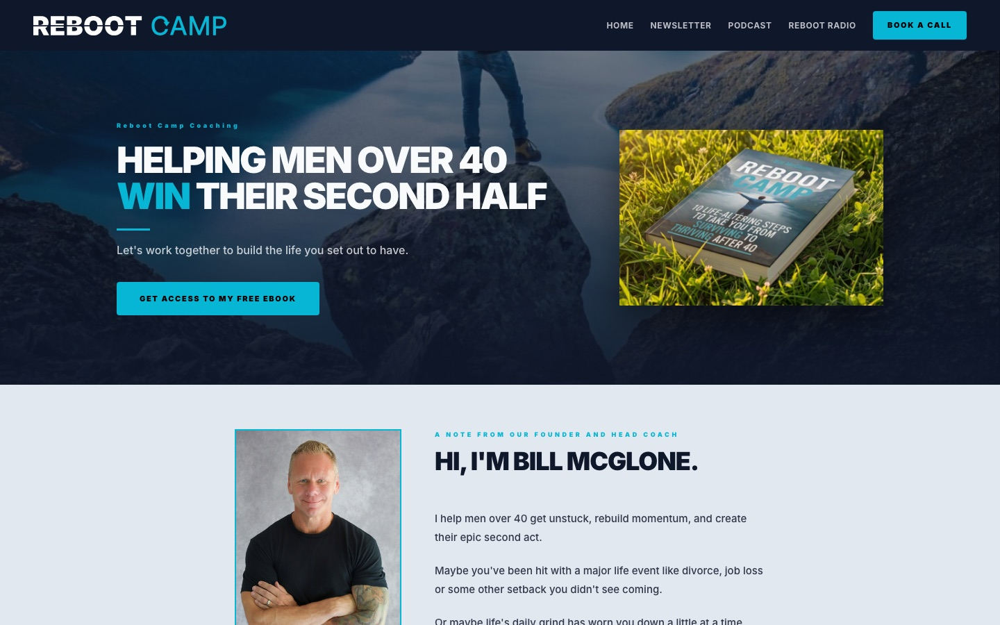</a>
 <b><a href="https://rebootcampcoaching.com">Reboot Camp Coaching</a></b> 
Client site + ebook pipeline. One HTML source builds the site, the PDF and the EPUB.
</td>
<td width="50%" valign="top">
<a href="https://crescentpsychotherapy.com">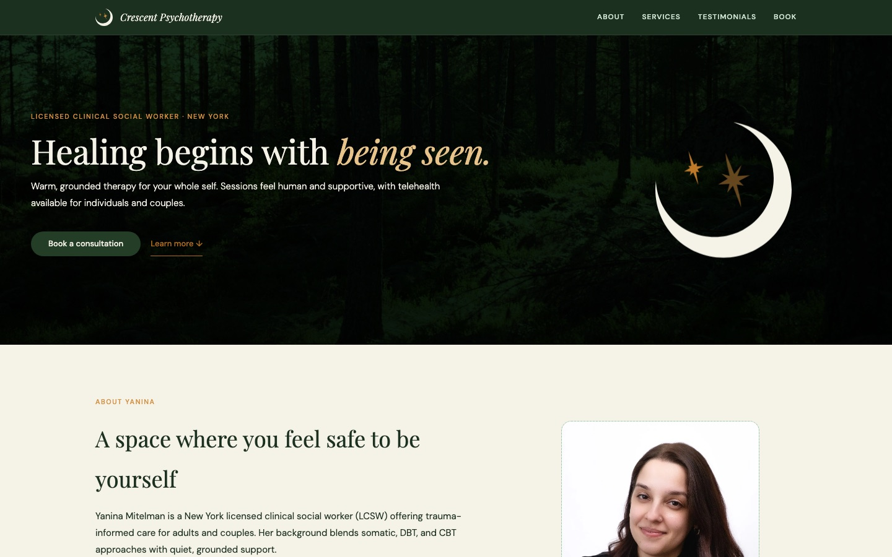</a>
 <b><a href="https://crescentpsychotherapy.com">Crescent Psychotherapy</a></b> 
Full digital identity for a NY clinician. Calm, warm, and nothing like a stock-photo therapy site.
</td>
</tr>
<tr>
<td width="50%" valign="top">
<a href="https://dlc35th.netlify.app">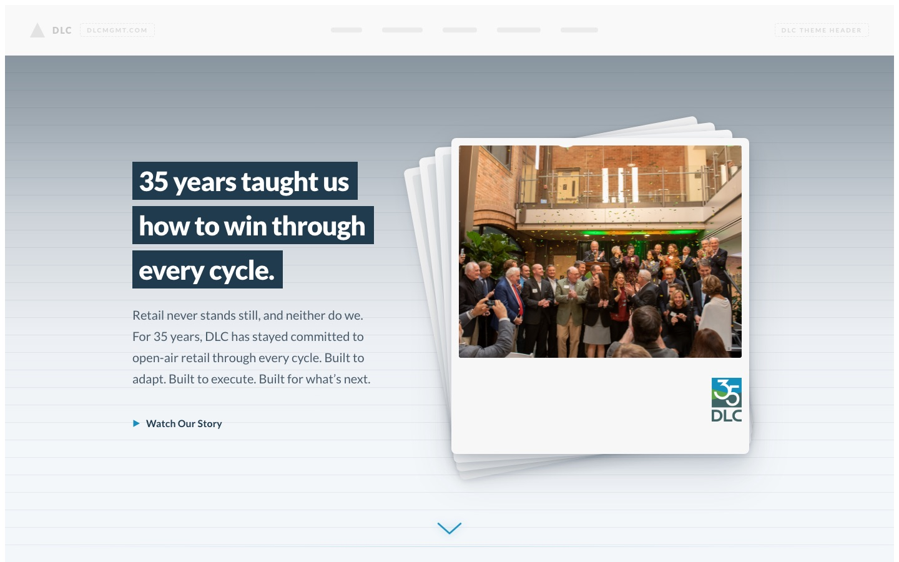</a>
 <b><a href="https://dlc35th.netlify.app">DLC · 35th Anniversary</a></b> 
Anniversary experience for a national retail real estate firm. Story-led, WordPress-ready.
</td>
<td width="50%" valign="top">
<a href="https://orderoffire.netlify.app">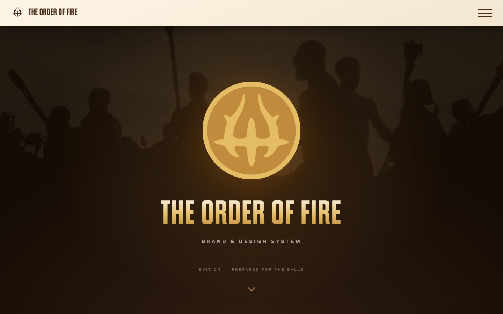</a>
 <b><a href="https://orderoffire.netlify.app">The Order of Fire</a></b> 
Brand & design system for a men's brotherhood. Mark, type, voice and rules, in one living guide.
</td>
</tr>
<tr>
<td width="50%" valign="top">
<a href="https://tangsoo.netlify.app">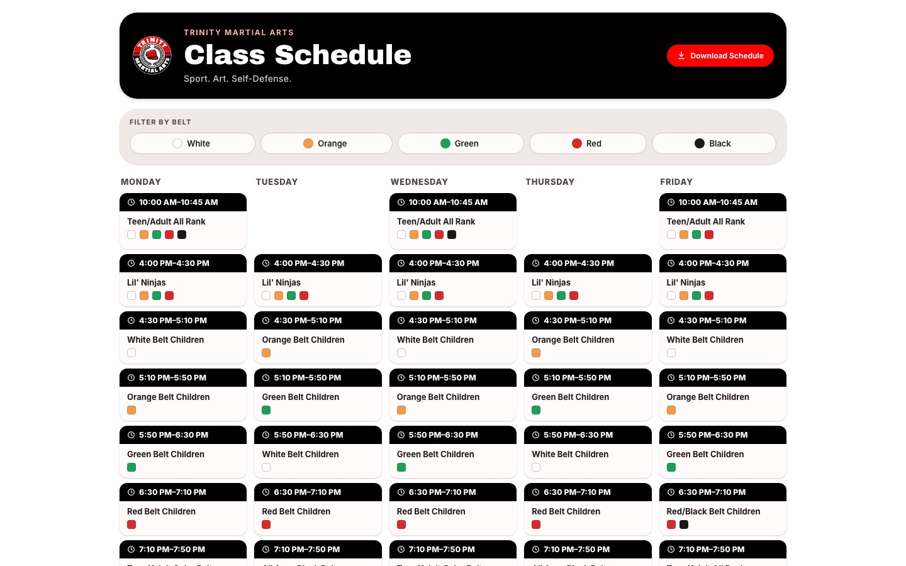</a>
 <b><a href="https://tangsoo.netlify.app">Trinity Martial Arts</a></b> 
A paper flyer reborn as a Material 3 app. One JSON file drives the web view and the printable PDF.
</td>
<td width="50%" valign="top">
<b>Off the browser</b>  
<b>DNC Widgets</b> · Swift · Liquid Glass macOS widgets for Mac stats, network and Claude plan usage.  
<b><a href="https://github.com/Medhuvir/AlienwareX14-RBG">AlienRGB</a></b> · C# · Replaced a bloated, cloud-gated vendor app with a tray utility that talks straight to the USB HID controller.  
<b>Client design hubs</b> · Private brand portals for studio clients. Ask nicely.
</td>
</tr>
</table>

 

## `04` · TRACK RECORD

| | |
|:--|:--|
| **Google** · Staff UX, Core AI | Agentic UX for Finance, Payroll & Vendor Management |
| **Prudential** · Director, UX | Shipped **LIV**, Prudential's first AI product, 0→1 in 12 months. **6 CX industry awards.** PruXpress redesign: **+15 NPS.** Scaled 8 → 16 Agile teams (+45% throughput) |
| **Northwell Health** · Director, UX | Built the design org from **0 → 15+ designers.** First design language; **37 microsites → one domain**, WCAG 2.1 baseline |
| **DealerTrack** | Chrome vehicle configurator, an automotive-industry first |
| **DN Creative** · Founder | Brand, web and product studio for teams who'd rather not look like everyone else |

SAFe · Cooper Design Leadership · $4M+ annual budgets managed · Regulated industries are my comfort zone.

 

## `05` · HOW I WORK

- **Design the autonomy, not just the screen.** Every agent needs a dial: suggest, draft, do-with-approval, do.
- **Prototype in production materials.** If it can be code, it's code. Figma for thinking, the browser for truth.
- **Systems over snowflakes.** Tokens, components, voice. Then go fast.
- **Ship, then sand.** Strong opinions, loosely held, tested with real users.

**Toolkit:** Figma · Claude Code · OpenClaw · Ollama · React · TypeScript · Supabase · Netlify · Swift · Adobe CC · a Mac mini that never sleeps

 

## `06` · CONNECT

**[LinkedIn](https://www.linkedin.com/in/dannemirovsky/)** · **[Portfolio](https://dannemirovsky.com)** · **[DN Creative Studio](https://dncreative.studio)** · **[Design Hub](https://hub.dncreative.studio)**

New York · Designed & built by DN Creative · Design that doesn't blend in.
